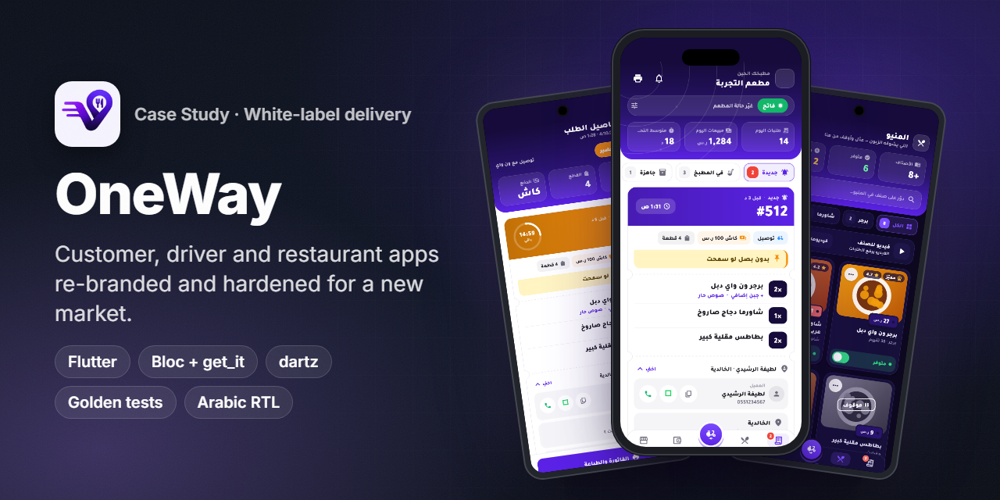
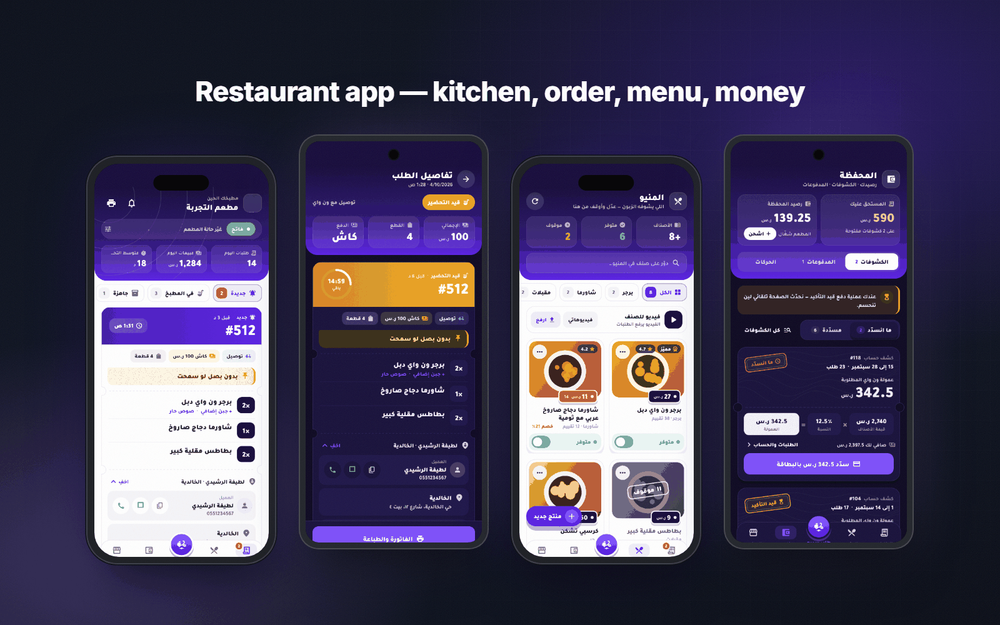
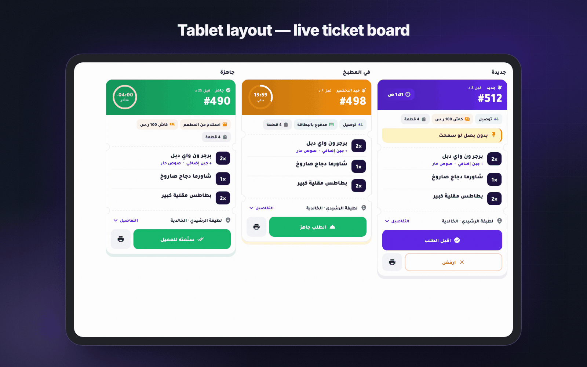
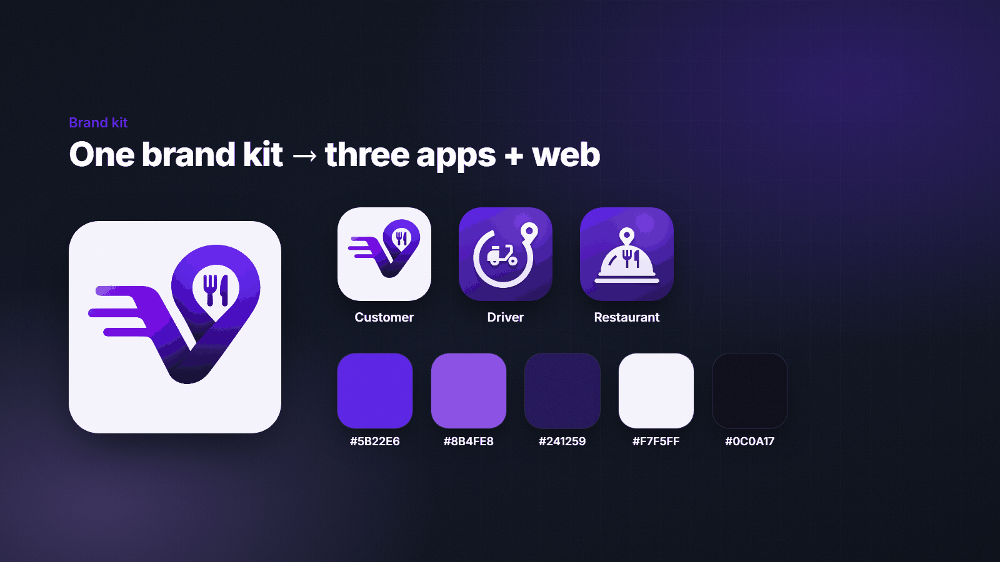
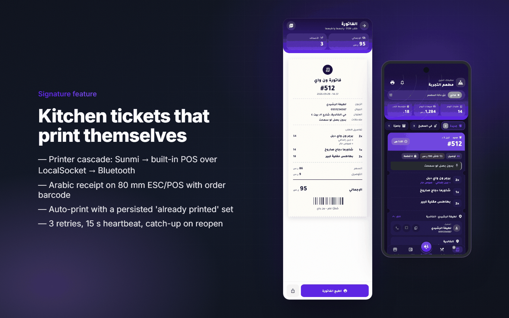
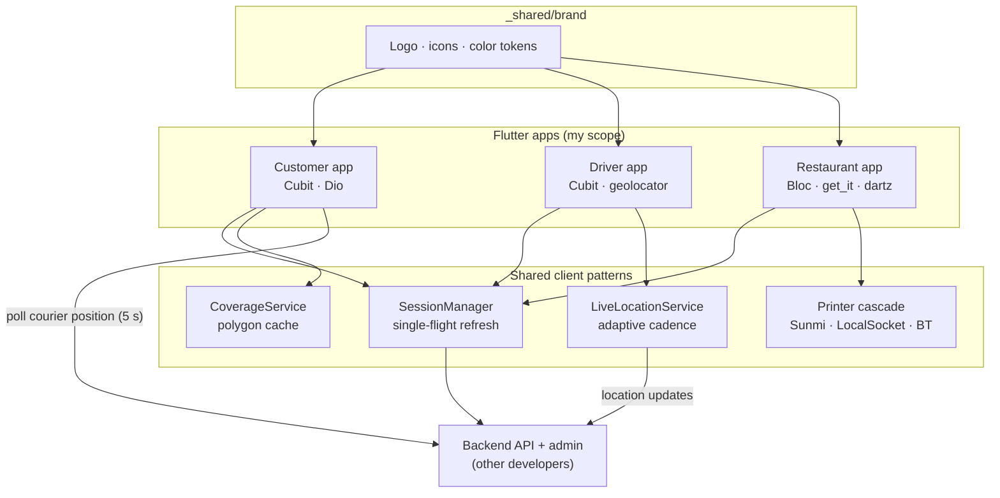

<h1 align="center">OneWay Fast Food</h1>

<b>A production delivery platform rebranded and hardened for a new operator: customer, driver and restaurant apps under one purple brand kit.</b>

  
  
  
  
  
  

> ℹ️ This is a case study. The source code belongs to the client and is not included.

## Overview

**OneWay Fast Food** is a white-label redeployment of the delivery platform I built for [Talabatek](https://github.com/ANaSHaker/talabatek-case-study). A new operator wanted the same proven product (customer, driver and restaurant apps) under its own brand, currency and market settings, without starting from scratch.

**My role was the full mobile delivery.** I did the following:

- forked the three Flutter apps
- replaced the brand identity across them
- separated out market-specific settings
- set up new app IDs
- added several features that the original platform did not have yet:
  - adaptive live driver location
  - courier tracking on the map
  - polygon coverage zones
  - checkout memory
  - golden tests

As on Talabatek, the backend and admin dashboard came from other developers.

The work took place in September and October 2026. Each app was moved into its own repository with its own identity (`com.oneway.userapp`, `com.oneway.delivery` and `com.oneway.restaurant`).

## The challenge

- **Rebrand without forking the product forever.** The apps had grown on Talabatek's orange identity, with hundreds of hard-coded `Colors.orange` shades. That color had to change in one place, not hundreds.
- **A new market, new assumptions.** Currency, support numbers and default city were hard-coded for Palestine. They had to be found and moved into configuration.
- **Features the new operator needed at launch:** live courier tracking for customers, polygon-based delivery zones and a smoother repeat checkout.
- **Confidence without a QA team.** A restaurant app with dozens of screens needs protection against visual regressions every time the brand or layout changes.

## Highlights

**🎨 White-label rebrand**
- Each app has one `brand.dart` that defines a single `MaterialColor` swatch (`kBrand`). Every former orange reference now resolves through it.
- Python icon generators build Android adaptive and monochrome icons, iOS icons, splash images and store icons from one 1024 px master mark.
- A compile-time `AppEnv` switch selects the environment.

**🛒 Customer app**
- Live courier tracking on the map, coverage-aware address picking and OTP login with a server-driven resend timer.
- Checkout memory that pre-fills repeat orders per account and per address.
- Free-delivery offers (new-customer offers and "every N orders" rewards) with correct Arabic plurals.

**🛵 Driver app**
- **Adaptive live location:** a fast, precise update rate while carrying an order, a slow rate while idle and nothing while offline.
- Order alerts, Accept and Reject actions, and one-tap calling.

**🍽️ Restaurant app (the cleanest codebase)**
- Uses feature-first structure with `data/` (repos, models) and `views/` (cubit, screens, components), plus a shared `core/`.
- `get_it` provides the service locator, and repositories return `dartz` `Either` results. Connectivity checks use `NetworkInfo`.
- Kitchen board, order details, menu with video, money hub (wallet and statements) and reviews.
- Phone and **tablet** layouts in light and dark.
- **Automatic thermal printing** of Arabic receipts on Sunmi, built-in POS and Bluetooth printers.

## Screens

Restaurant app: kitchen dashboard, order details (dark), menu and money hub (dark).

Tablet layout: a three-column ticket board (new, in the kitchen, ready) with countdown rings.

Shared brand kit: logo, per-app icons and the color tokens used in every app.

> The screens above are rendered by the restaurant app's own **golden (visual-regression) tests**, using fixture data. The names and phone numbers in them are fake. The apps had no public store listing at the time of writing.

## Signature feature: white-label in one constant, printing that just works

**Printing.** The restaurant app keeps Talabatek's printing pipeline:

1. It tries printers in this order: a Sunmi printer through the SDK, then a native Java `PrinterClient` that writes ESC/POS bytes to the built-in printer over Android's **`LocalSocket`**, then a Bluetooth printer.
2. Receipts are formatted for 80 mm paper. They include the order number, line items, totals and a barcode, with Arabic sent as UTF-8.
3. Auto-print keeps a saved set of printed order IDs and retries each order up to three times. A 15-second heartbeat runs while the app is open, and the app catches up on missed orders when it reopens.

**Rebrand.** The whole palette lives in `kBrand`. Changing the brand means changing one swatch and regenerating the icons, with no find-and-replace across screens. Leftovers from the old market (currency, support phone numbers and the default city) were tracked down and documented in code comments.

## Architecture & stack

| Layer | Tech |
|---|---|
| UI | Flutter with a brand swatch per app, light and dark palettes, Arabic RTL (33 restaurant files set `TextDirection.rtl` explicitly), TheSans and Tajawal fonts |
| State & DI | `flutter_bloc` (Cubits). The restaurant app uses `get_it`, `dartz` and `equatable` |
| Networking | `dio` with a `SessionManager` shared by every app (including the web client, which uses `localStorage`) |
| Maps & location | `flutter_map` and `latlong2` for courier tracking, `google_maps_flutter` and `geolocator` |
| Printing | `sunmi_printer_plus`, `esc_pos_utils_plus`, a native `LocalSocket` bridge, `pdf`/`printing`, `barcode_image` |
| Push | Firebase Cloud Messaging and `flutter_local_notifications` |
| Testing | 9 golden suites in the restaurant app (about 62 tests: phone and tablet, light and dark) and unit tests for checkout memory, offers, city matching and vendor messages |

## Engineering notes

- **Adaptive live location (driver app).**
  - `LiveLocationService` sends nothing while the driver is offline.
  - While online and idle, it reports every 60 s at medium accuracy. While carrying an order, it reports every 10 s at high accuracy.
  - It only sends after the driver has moved 15 m or 30 s have passed, and it sends immediately when the first order is accepted.
  - The result is fresh positions for customers without draining batteries on idle shifts.
- **Smooth courier tracking (customer app).** The tracking screen polls every 5 s and *animates* the courier marker between readings (a 4.5 s animation), so it glides instead of jumping. It guards against NaN and out-of-range coordinates.
- **Polygon coverage zones.** City and district polygons are cached on the device and refreshed in the background. A point-in-polygon check runs locally while the user drags the map pin, so the "we deliver here" answer is instant. The server confirms the result, and the service never throws.
- **Offline-safe checkout memory.**
  - Details such as the name and alternate phone are saved per account and per saved address, but only *after* an order succeeds. A failed order never overwrites good data.
  - Notes are never saved, and everything is cleared on logout.
  - Unit tests cover staging and commit, failure isolation and per-account separation.
- **Rotation-safe token refresh.** Parallel 401 responses share one in-flight refresh, because reusing a refresh token revokes the whole token family. The refresh call uses a separate Dio client with no interceptors, to avoid recursion. Only a 401 ends the session; a 429, a 503 or a network error keeps it.
- **OTP done right.** The server verifies the code. The resend countdown comes from the server's `resendAfter` value. The code fields stay left-to-right inside the RTL layout, and the OTP screen survives Android killing the app.

## Results

- **3 Flutter mobile apps** rebranded and moved to their own repositories and app IDs, all sharing one brand kit.
- **About 62 golden tests and 62 reference screenshots** protecting the restaurant UI on phone and tablet, in light and dark.
- New platform capabilities (adaptive live location, courier tracking, polygon coverage and checkout memory) built for this deployment.
- No public store listing could be found at the time of writing, so no install figures are given.

## Part of a white-label platform

The same platform was redeployed for three brands, each with its own identity:

| Repo | Brand | What it shows |
|---|---|---|
| [talabatek-case-study](https://github.com/ANaSHaker/talabatek-case-study) | Talabatek · طلباتك | The original platform: customer, driver, restaurant and Flutter web apps, live in Palestine |
| **[oneway-case-study](https://github.com/ANaSHaker/oneway-case-study)** | OneWay Fast Food (this repo) | A white-label redeployment with a new brand kit, golden tests and adaptive live location |
| [gahez-case-study](https://github.com/ANaSHaker/gahez-case-study) | Jahiz · جاهز | The same foundations reshaped into a home-services marketplace |

## بالعربي

**ون واي** نسخة white-label من منصة التوصيل التي بنيتها لطلباتك، أُعيد إطلاقها بهوية بصرية جديدة لمشغّل جديد.
الهوية كلها في ثابت لوني واحد (`kBrand`)، ومولّدات تبني كل الأيقونات وشاشات البداية من شعار واحد، ونقلتُ إعدادات السوق (العملة، أرقام الدعم، المدينة الافتراضية) من الكود إلى الإعدادات.
أضفتُ مزايا جديدة: تتبّع موقع السائق بمعدّل يتكيّف مع حالته، وتحريك السائق على الخريطة بسلاسة، ونطاقات تغطية بالمضلّعات تُفحص على الجهاز، وذاكرة للطلب تحفظ البيانات لكل حساب.
تطبيق المطعم محمي بـ 62 اختبار golden على الهاتف والتابلت بالوضعين الفاتح والداكن، ويطبع فواتير عربية تلقائيًا على طابعات Sunmi وطابعات POS المدمجة.

## Links

- The apps had no public store listing at the time of writing.
- Related: [Talabatek case study](https://github.com/ANaSHaker/talabatek-case-study) · [Jahiz case study](https://github.com/ANaSHaker/gahez-case-study)

---
<h3 align="center">Built by Mahmoud Shaker — Senior Flutter Engineer</h3>

  
  
  
  
  
  
  

